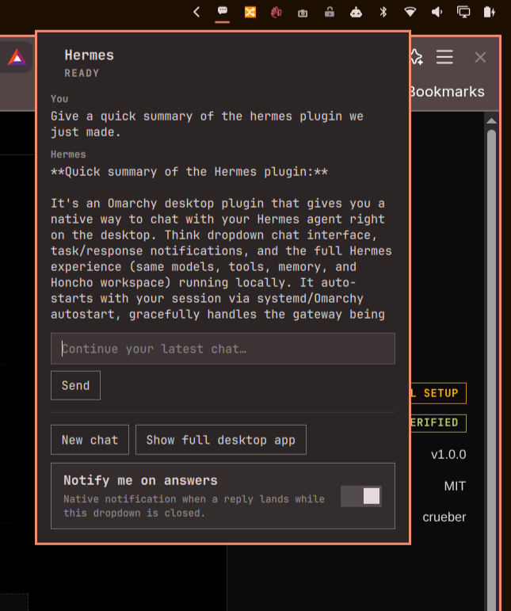

# Hermes Chat (Omarchy plugin)



A bar icon for the Omarchy shell (Quickshell) that lets you send a quick
message to your local [Hermes](https://github.com/NousResearch) agent from
the dropdown, without opening the desktop app.

This is a shell plugin, not a Hermes desktop-app plugin — it talks to your
locally installed `hermes` CLI directly. It works whether or not the Hermes
Electron app is open, and does **not** require the persistent gateway
(`hermes gateway run`) to be running.

## What it does

- **Bar icon** — a small chat-bubble mark; turns to your bar's urgent color
  if the `hermes` command isn't found on PATH.
- **Optional keyboard shortcut** — toggle the dropdown without touching the
  mouse. Not wired automatically; see [Optional: keyboard
  shortcut](#optional-keyboard-shortcut) below.
- **Quick chat** — type a message, hit Enter (or click Send). It runs
  `hermes -z "<message>" -c` (one-shot mode, continuing your most recently
  active Hermes conversation) and shows the reply inline. One-shot turns can
  take anywhere from a few seconds to tens of seconds — the panel shows
  "Thinking…" and a Stop button; you can keep using the rest of your
  desktop while it runs.
- **New chat** — the next message you send starts a fresh conversation
  (drops `-c`) instead of continuing the latest one.
- **Show full desktop app** — focuses the Hermes window if it's already
  open (`hyprctl dispatch focuswindow`), or launches it
  (`hermes desktop --skip-build`) if it isn't.
- **Notify me on answers** — a toggle, persisted (along with your recent
  conversation) to `~/.local/state/omarchy/hermes-chat/state.json`. When
  on, you get a `notify-send` notification with a preview of the reply,
  but only if the dropdown was closed when the reply arrived (so you don't
  get pinged for something you were already watching).
- **About** — the 󰋽 info button next to the dropdown's "Hermes" title
  swaps the chat for an About page: version, license (readable in place),
  Nine Point Labs, the support address,
  [help@ninepointlabs.com](mailto:help@ninepointlabs.com), with Email,
  Copy and "Copy version details" buttons, and what the plugin does with
  your data. The back button or <kbd>Esc</kbd> returns to the chat; closing
  the dropdown always brings you back to the chat next time.

## Dependencies

- The [Hermes](https://github.com/NousResearch) agent, with `hermes` on
  `$PATH` — this plugin is a thin front end over the CLI, not a
  reimplementation.
- Hyprland (`hyprctl`) and `notify-send`, both standard on an Omarchy
  install — used for "Show full desktop app" and reply notifications
  respectively. Neither is required for quick chat itself to work.
- `bash`, for the small scripts that read/write this plugin's own state
  file and shell out to the above.

No Node, Python, or other runtime is required — it's plain QML plus
standard command-line tools.

## Why "continue the latest chat" instead of "the focused session"

A GUI concept like "the session you have focused in the desktop app" isn't
visible to a shell plugin outside that app — there's no shared API between
Quickshell and the Electron renderer. `hermes -z ... -c` (continue the most
recent session) is the closest real equivalent the CLI exposes, and it's
what you get by default; "New chat" is there for when you explicitly want a
clean slate.

## Install

```bash
./install.sh
```

This copies the plugin's files into `~/.config/omarchy/plugins/hermes-chat`,
runs `omarchy bar put tim.hermes-chat` to add the icon to the right section
of your bar, then runs `omarchy restart shell`.

**Re-run `./install.sh` after every edit.** Files are copied, not
symlinked — there's no live-reload shortcut here. Worse, on this machine
neither the plugins-dir file watcher nor the `omarchy-shell shell
rescanPlugins` IPC call reliably picked up a changed file (confirmed by
directly instrumenting the QML and watching it keep rendering stale output
through several rescans) — only a full `omarchy restart shell` was
observed to actually reload it, so that's what this script does every time.
It only restarts the shell chrome (bar/panels); other running apps are
unaffected.

If you ever want to move it, remove it from the bar, or re-add it:

```bash
omarchy bar move tim.hermes-chat --section left   # move it
omarchy bar put tim.hermes-chat --before omarchy.tray
omarchy plugin disable tim.hermes-chat            # take it off the bar
omarchy plugin enable tim.hermes-chat             # put it back
```

## Optional: keyboard shortcut

Not set up by `install.sh` — it edits your Hyprland config, which felt
like the wrong thing to do without asking. To toggle the dropdown with a
key combo instead of clicking the bar icon, add a line like this to
`~/.config/hypr/bindings.lua` (pick any combo `omarchy menu keybindings
--print` doesn't already list):

```lua
o.bind("SUPER + H", "Hermes chat", "omarchy-shell shell toggle tim.hermes-chat")
```

Then run `hyprctl reload`.

Inside the dropdown: <kbd>Enter</kbd> sends, <kbd>Esc</kbd> closes it (or,
on the About page, goes back to the chat).

## Uninstall

```bash
omarchy plugin disable tim.hermes-chat
rm ~/.config/omarchy/plugins/hermes-chat
rm -rf ~/.local/state/omarchy/hermes-chat   # drops the conversation/notify state too
```

If you set up the optional keybind above, remove that line from
`~/.config/hypr/bindings.lua` and run `hyprctl reload` — otherwise it just
no-ops harmlessly once the plugin is gone.

## Notes for future changes

Built against the Omarchy shell's actual plugin contract, read straight out
of `/usr/share/omarchy/shell` (not guessed): `services/PluginRegistry.qml`
for the manifest schema and enable/bar-layout rules (its `~/.config/omarchy/plugins`
inotify watch exists but wasn't reliable for picking up an edit on this
machine — see Install above); `Ui/Panel.qml`,
`Ui/KeyboardPanel.qml`, `Ui/BarIconButton.qml`, `Ui/Button.qml`,
`Ui/TextField.qml`, `Ui/Toggle.qml`, and `Ui/PanelHero.qml` for the widget
base classes and controls this plugin builds on — same components
`nostr-signer` and `ring-cameras` use, so it should keep working across
Omarchy shell updates as long as those don't change shape. `omarchy plugin
validate <folder>` (ships with Omarchy) checks the manifest against the
current schema if something breaks later.

## Tests

```bash
node --test tests/
```

Checks the About page's facts against the real `manifest.json`, `LICENSE`
and first commit, and its privacy statement against `Panel.qml`: that the
message still goes to the local `hermes` CLI over stdin, where the
transcript is stored, and that no network host or network client is added
to the plugin without being named there. Needs only Node; nothing runs
`hermes` or touches the network.

## License

MIT — see [LICENSE](LICENSE).
